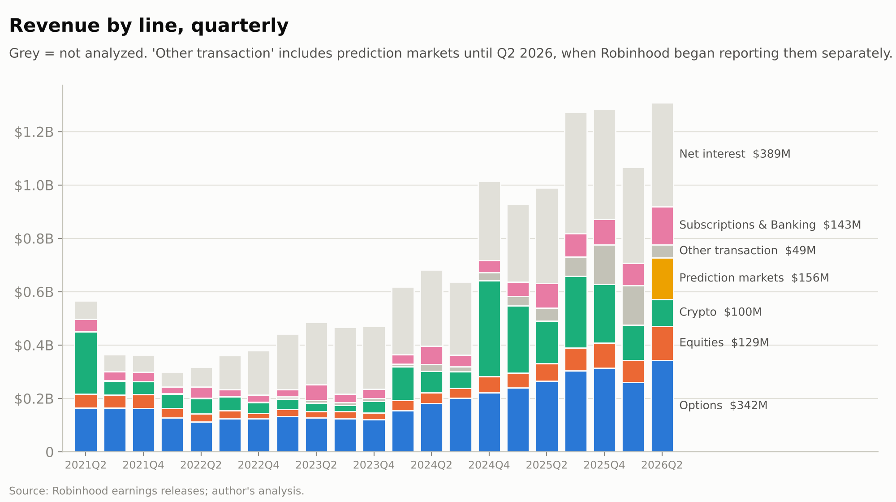
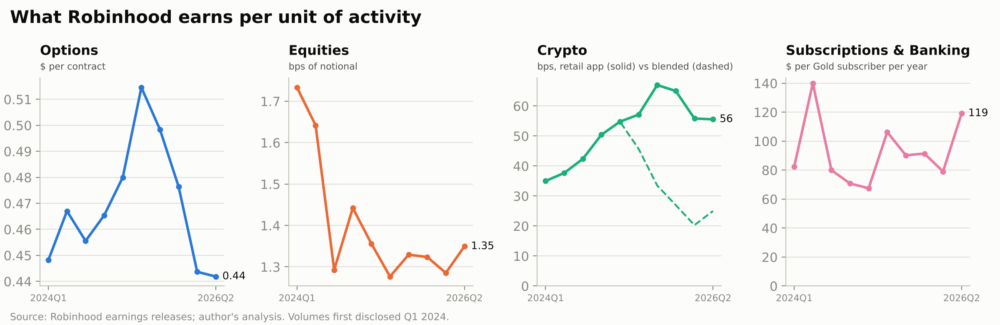
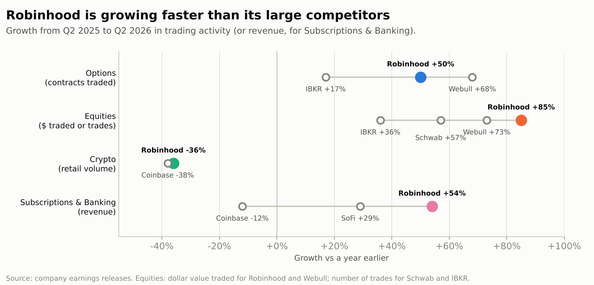
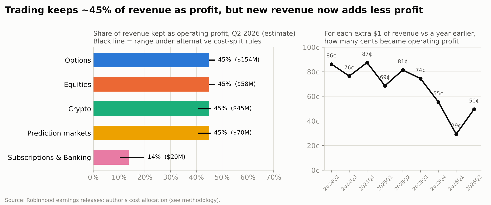
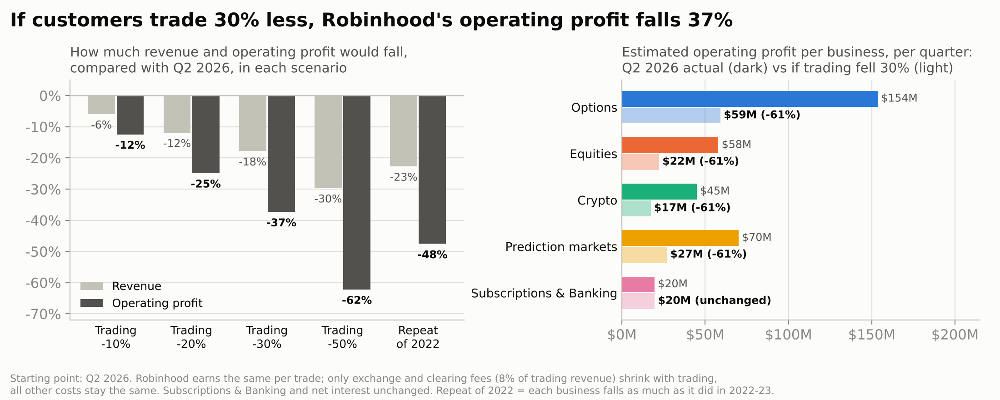
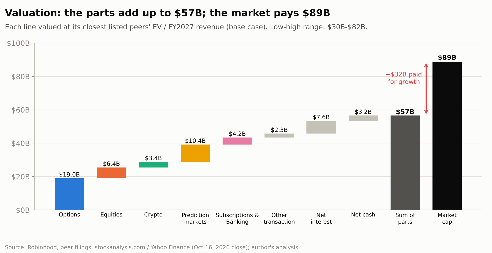
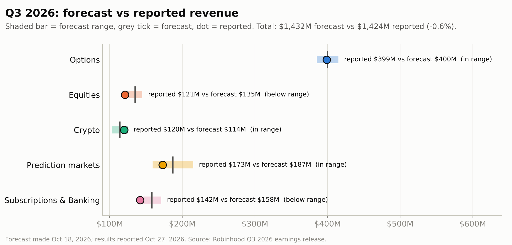
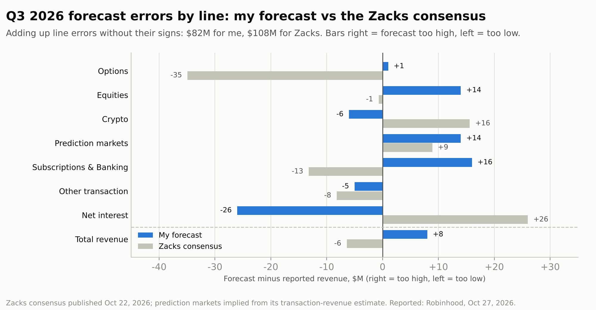

# Robinhood, Unbundled

**Robinhood reports revenue for each of its products but profit only for the whole company. This project splits Robinhood (NASDAQ: HOOD) into five businesses and asks the same questions of each: does it make money, how much does it earn per trade or customer, is it beating its competitors, is it growing, and what is it worth?**

[Interactive dashboard (Tableau Public)](https://public.tableau.com/app/profile/julie.loyez/viz/RobinhoodUnbundled/RobinhoodUnbundled)

*Data through Q2 2026 (April–June). Share prices as of the October 16, 2026 close. Q3 2026 revenue forecast made October 18, 2026 and scored against Robinhood's report on October 27, 2026.*

---

## Summary

| Business | Revenue, Q2 2026 | Growth vs Q2 2025 | Est. profit margin | Est. value |
|---|---|---|---|---|
| Options | $342M | +29% | ~45% | $19.0B |
| Equities (stocks) | $129M | +95% | ~45% | $6.4B |
| Crypto | $100M | −38% | ~45% | $3.4B |
| Prediction markets | $156M | more than 10× (per Robinhood) | ~45% | $10.4B |
| Subscriptions & Banking | $143M | +54% | 14% | $4.2B |

*Profit margin = share of revenue left after all costs. The four trading businesses show the same ~45% because Robinhood doesn't disclose which costs belong to which product (see [How much profit each business makes](#how-much-profit-each-business-makes)).*

**What I found:**

1. **Trading revenue grows because people trade more, not because Robinhood charges more.** Robinhood earns about $0.44 per options contract, roughly the same as in early 2024. Among the brokers that publish comparable numbers, its share of options contracts rose from 50% in Q2 2025 to 54% in Q2 2026.
2. **Each extra trade is almost pure profit.** Exchange and clearing fees are only about 8% of trading revenue; salaries, technology and marketing cost the same whether customers trade a little or a lot.
3. **But growth now turns into less profit than before.** From mid-2024 to Q3 2025, each extra $1 of revenue (vs a year earlier) added 69–87¢ of operating profit. In the next three quarters it added 29–55¢, as costs grew 33% in a year to pay for new projects.
4. **Prediction markets already bring in more than crypto:** $156M vs $100M in Q2 2026, about a year after launch.
5. **If customers trade less, profit falls twice as fast as revenue.** A 30% drop in trading would cut revenue by 18% but operating profit by 37%.
6. **The stock is priced well above what its businesses are worth at competitors' prices.** Valuing each business like its closest listed competitor gives about $57B; the stock market valued Robinhood at $89B. Investors are paying about $32B extra, betting that fast growth continues.
7. **My Q3 forecast landed within 0.6% of reported revenue**, and was more accurate line by line than the Zacks consensus. The misses taught more than the hit (see [What I got wrong, and why](#what-i-got-wrong-and-why)).



### Terms used

- **Quarters:** Q2 2026 = April–June 2026; Q3 2026 = July–September 2026.
- **Take rate / earnings per trade:** what Robinhood earns per unit of customer activity: dollars per options contract, or cents per $100 traded.
- **Basis point (bp):** one hundredth of one percent. Earning 1 bp on $10,000 of stock traded means earning $1.
- **Operating profit / profit margin:** revenue minus the costs of running the business (before interest and taxes); the margin is that profit as a share of revenue.
- **Market cap:** share price × number of shares, i.e. what the stock market says the company is worth.
- **Revenue multiple:** a company's value divided by its yearly revenue. A company worth $100B with $10B of revenue trades at "10× revenue".

---

## The five businesses

**Options.** $342M of revenue in Q2 2026, the largest business. Robinhood customers traded 774M contracts, 50% more than the 515M in Q2 2025 (Interactive Brokers +17%, Webull +68% from a smaller base). Revenue grew less (+29%) because earnings per contract slipped from $0.51 to $0.44.

**Equities (stocks).** $129M. Customers bought and sold $956B of stocks, 85% more than the $517B in Q2 2025, faster than Webull (+73%); Schwab and Interactive Brokers, which only publish trade counts, grew 57% and 36%. Robinhood earns about 1.35 bps per dollar traded ($13.50 per $100,000).

**Crypto.** $100M, down 38% from $160M. Total crypto revenue ÷ total crypto traded suggests Robinhood earns much less per trade than before (25 bps vs 55 bps in mid-2025), but that's because it bought **Bitstamp**, an exchange for professional investors with much lower fees. Separated, the Robinhood app still earns about 55 bps and Bitstamp about 0.5 bps. Crypto traded on the app fell from $28B to $18B (−36%), in line with Coinbase's retail customers (−38%). Coinbase earns about 175 bps per dollar traded, three times Robinhood.

**Prediction markets.** $156M, about 1.1¢ per contract on 13.6 billion contracts. A prediction-market contract must be listed on a regulated exchange. Until June 2026, Robinhood mostly let its customers buy contracts listed on other exchanges, mainly Kalshi, which charges its own fee; Kalshi reportedly brings in over $4B a year across all its customers (press reports). In June, Robinhood launched its own exchange, **Rothera**, with Susquehanna, so it can keep the exchange's fee too. Some US states argue prediction markets are illegal gambling.

**Subscriptions & Banking.** $143M from Gold subscriptions, Trump Account services, the Gold credit card and Robinhood Banking (+54% from $93M). Gold subscribers grew from 3.5M to 4.8M; about 40% of new customers sign up. It is the least profitable business (14% margin), mostly because of $56M set aside for unpaid card balances, while the card's interest income is counted under "net interest". It's also the steadiest, and keeps customers' money on the platform.





**Not analyzed in detail, but kept in all totals:** net interest (interest earned on customers' cash and on loans to customers, 30% of revenue) and other transaction revenue (futures and other small products, 4%).

---

## How much profit each business makes

Robinhood reports costs only for the whole company, so each business's profit is estimated with simple rules: exchange and clearing fees go to the trading businesses in proportion to their revenue; credit-card losses go to Subscriptions & Banking; everything else (engineers, offices, marketing, management) is shared by all businesses in proportion to revenue. That's why the four trading businesses come out at the same ~45%; the meaningful comparison is trading (~45%) vs Subscriptions & Banking (14%). Alternative rules move the margins by only a few points.



For the company, operating margin was 44% in Q2 2026, the same as a year earlier, even though revenue grew 32%: costs grew just as fast (+33%), funding Rothera, Trump Accounts (over 7M sign-ups since July 4, 2026), international expansion and acquisitions.

---

## What if customers trade less?

Imagine customers trade 10–50% less than in Q2 2026. Robinhood still earns the same per trade, so trading revenue falls by the same percentage. Only exchange and clearing fees (8% of trading revenue) shrink with it; all other costs ($672M a quarter) stay the same in the short run. Subscriptions & Banking and net interest are kept unchanged.

| Scenario | Total revenue | Operating profit | Profit margin |
|---|---|---|---|
| Q2 2026 actual | $1,308M | $574M | 44% |
| Trading −10% | −6% | −12% | 41% |
| Trading −20% | −12% | −25% | 37% |
| Trading −30% | −18% | −37% | 33% |
| Trading −50% | −30% | −62% | 24% |
| Repeat of 2022* | −23% | −48% | 30% |

*Each business falls as much as its revenue did from late 2021 to the 2022–23 low: options −31%, stocks −60%, crypto −52%.



- **Profit falls about twice as fast as revenue**: the same fixed costs that made recent years so profitable, working in reverse.
- **For each trading business, a 30% drop in trading cuts profit by about 60%**; Subscriptions & Banking is unaffected.
- **Robinhood stays profitable unless trading falls about 80%** (with no cost cuts).
- Crypto revenue moves most with markets, then stocks, then options; Subscriptions & Banking least. The Bitcoin price lines up with every trading business, while the VIX (an index of stock-market nervousness) doesn't, which suggests Robinhood's trading follows how much risk its customers want to take.

---

## What is Robinhood worth?

Each business is valued like its closest listed competitor, using value ÷ revenue expected for 2027 (analyst average: $6.85B in total, split using this project's forecast).

| Business | 2027 revenue | Value ÷ revenue (low – middle – high) | Compared with | Value, middle |
|---|---|---|---|---|
| Options | $1.9B | 4.1× – 9.9× – 15.8× | Schwab – Interactive Brokers | $19.0B |
| Equities | $0.6B | 4.1× – 9.9× – 15.8× | Schwab – Interactive Brokers | $6.4B |
| Crypto | $0.5B | 5.0× – 6.2× – 7.5× | Coinbase | $3.4B |
| Prediction markets | $0.9B | 5.5× – 11.6× – 14.6× | Kalshi – stock exchanges – CME | $10.4B |
| Subscriptions & Banking | $0.8B | 3.1× – 5.5× – 8.0× | SoFi (upper end is a judgment call) | $4.2B |
| Other transaction + net interest | $2.1B | | Schwab, Interactive Brokers, SoFi | $9.9B |
| Cash minus debt | | | | $3.2B |
| **Total** | | | | **$57B (range $30–82B)** |
| **Stock market value, Oct 16, 2026** | | | | **$88.9B** |



- The stock market values Robinhood at $89B; valuing each business like its competitors gives $57B in the middle case, and only $82B with the most generous assumptions. **The stock is expensive compared with what its businesses earn today.** Investors pay the extra ~$32B because they expect much faster growth than competitors, and because new projects (Rothera, international, Trump Accounts) could become large businesses. If growth slows to a normal broker's pace, ~$57B is the more realistic anchor.
- **The size of that bet:** if the whole extra $32B were attributed to prediction markets, investors would be valuing that one business at about $43B, or 48 times its yearly revenue, while comparable exchanges are valued at 6–15 times. That's about twice Kalshi's last valuation.
- **Adjusted for growth, the price looks more reasonable:** Robinhood is valued at 12.5× next year's expected revenue, which is expected to grow about 39%. Per point of growth, that's cheaper than Interactive Brokers or Coinbase, though more expensive than Schwab or SoFi.

---

## Q3 2026 forecast, and how it did

**The method (made October 18, nine days before the report).** Robinhood publishes how much its customers trade each month. For each business: activity in July, August and September (September estimated from its first 24 days) × what Robinhood earned per trade in Q2. Tested on the previous nine quarters, the method was off by 3.8% on average for options and 7.5% for stocks; those errors set the ranges.

| Business | My forecast | Range | Zacks consensus (Oct 22)* | Reported (Oct 27) | My error |
|---|---|---|---|---|---|
| Options | $400M | $385–415M | $364M | $399M | +0.3% |
| Equities | $135M | $125–145M | $120M | $121M | +11.6% |
| Crypto | $114M | $103–125M | $136M | $120M | −5.0% |
| Prediction markets | $187M | $159–215M | $182M | $173M | +8.1% |
| Subscriptions & Banking | $158M | $143–171M | $129M | $142M | +11.3% |
| Other transaction | $49M | $47–51M | $46M | $54M | −9.3% |
| Net interest | $389M | $370–408M | $441M | $415M | −6.3% |
| **Total revenue** | **$1,432M** | **$1,332–1,530M** | **$1,418M** | **$1,424M** | **+0.6%** |

*Zacks Equity Research, published Oct 22, 2026 (headline "$1.42 billion"; $1,418M is the sum of its revenue categories). Its prediction-markets figure is implied from its transaction-revenue estimate.



**Compared with Zacks:** Zacks was slightly closer on the total (−0.5% vs my +0.6%), but my forecast was more accurate line by line: adding up each line's error without its sign gives $82M for me and $108M for Zacks. The biggest gap was options, where the monthly activity data got me within $1M while the consensus was $35M low.



### What I got wrong, and why

1. **Trading activity was right; earnings per trade weren't.** I predicted activity almost exactly (options contracts 906M vs 905M; stocks traded $998B vs $992B; prediction-market contracts 16.3B vs 16.4B). But Robinhood earned 1.22 bps per dollar of stock traded instead of Q2's 1.35 (its lowest ever), and 1.05¢ per prediction contract instead of 1.15¢. Zacks expected the lower stock revenue; I used Q2's rate, which was at the top of its recent range. On prediction markets Zacks was also too high, so that drop surprised others too.
2. **Net interest (−$26M, my biggest miss).** I held it flat, but Robinhood's monthly margin book (money lent to customers) had grown about 7% by July–August. Growing net interest with it would have given $417M vs $415M reported. The data was there; I didn't use it.
3. **Subscriptions & Banking (+$16M).** I grew it with Gold subscribers, but its Q2 jump (from $85M to $143M) came mostly from Trump Account fees, not Gold. It stayed flat at $142M even as Gold grew to 5.2M. Holding it flat would have been almost exact. I mistook a one-off jump for a trend.
4. **The total hid the misses.** Errors in opposite directions cancelled out. Fixing items 2 and 3 would have made those lines nearly exact but moved the total further away (+1.4%), because nothing would have offset item 1 anymore. Forecasts should be judged line by line.

### What I'd do differently next quarter

 model net interest from the monthly margin book; split Gold from Trump Account fees; use a range of recent earnings per trade instead of only the last quarter's; score every line.

---

## Limits

- **Profit by business is an estimate**, based on the cost-split rules above.
- **Short history:** Robinhood only started publishing trading volumes in 2024 and prediction-market revenue in Q2 2026.
- **The trading-drop test is short-run:** no cost cuts, constant earnings per trade, Gold revenue and net interest unchanged.
- **Valuations change daily;** the Subscriptions & Banking multiple and Kalshi's revenue are the least certain inputs.
- **Regulation:** prediction markets and crypto both face open legal questions in the US.

---

## Reproduce it

```
pip install -r requirements.txt
python src/fetch_market.py      # VIX, Bitcoin and valuation snapshot (Yahoo Finance; FRED fallback)
python src/build_dataset.py     # merge quarterly releases, check totals, compute take rates
python src/forecast_q3.py       # Q3 2026 forecast + backtest (built on data through Q2 2026)
python src/vertical_pnl.py      # profit by business + incremental margin
python src/competitors.py       # growth vs competitors
python src/revenue_quality.py   # how much each business moves with markets
python src/volume_stress.py     # trading-drop test
python src/sotp.py              # sum-of-the-parts valuation
python src/score_q3.py          # forecast vs reported
python src/forecast_review.py   # vs Zacks + fixes tested
python src/charts.py            # all figures
python src/build_tableau.py     # files for the Tableau dashboard
```

| Folder | Contents |
|---|---|
| `data/raw/` | Figures collected from Robinhood's quarterly and monthly releases, competitors' filings and market data (each row has its source URL) |
| `data/processed/` | Clean quarterly table, take rates, profit by business |
| `outputs/` | Forecast, scorecards, stress test, valuation, competitor and Zacks comparisons |
| `figures/` | Charts used in this README |
| `tableau/` | Data files behind the dashboard |
| `src/` | All code |

**Sources:** Robinhood quarterly earnings releases (SEC 8-K Exhibit 99.1, investors.robinhood.com) for Q2 2021–Q3 2026, each reconciled to reported totals; Robinhood monthly operating data (April–September 2026); competitors' earnings releases and filings (Interactive Brokers, Schwab, Coinbase, SoFi, Webull); Kalshi and Polymarket figures from press reports; Zacks Equity Research; Yahoo Finance and stockanalysis.com for prices and analyst estimates.

*An independent analytical project, not investment advice.*
