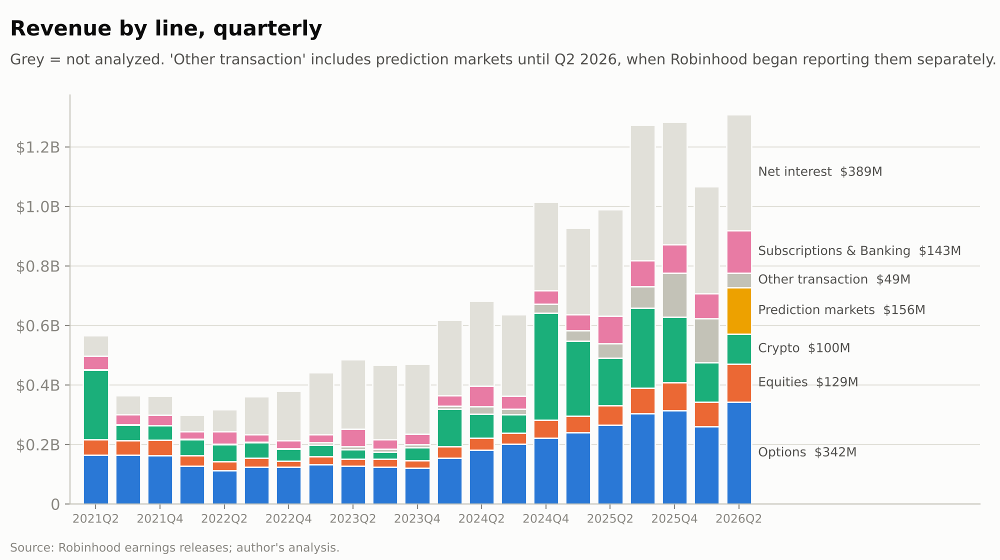
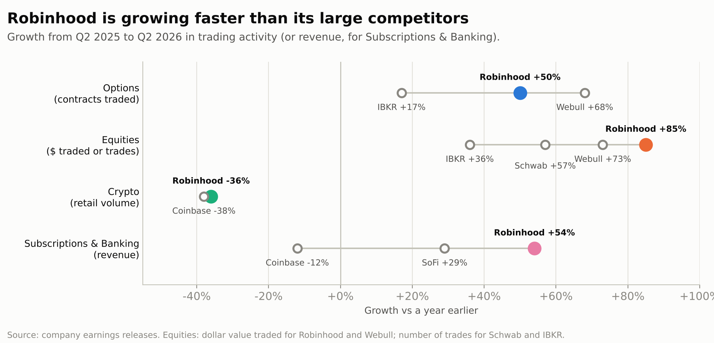
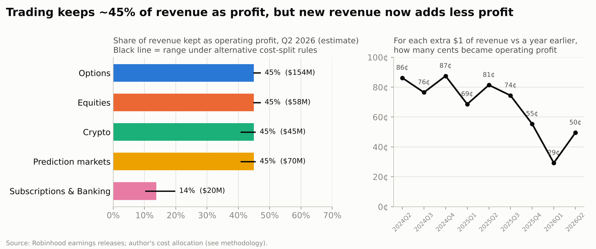
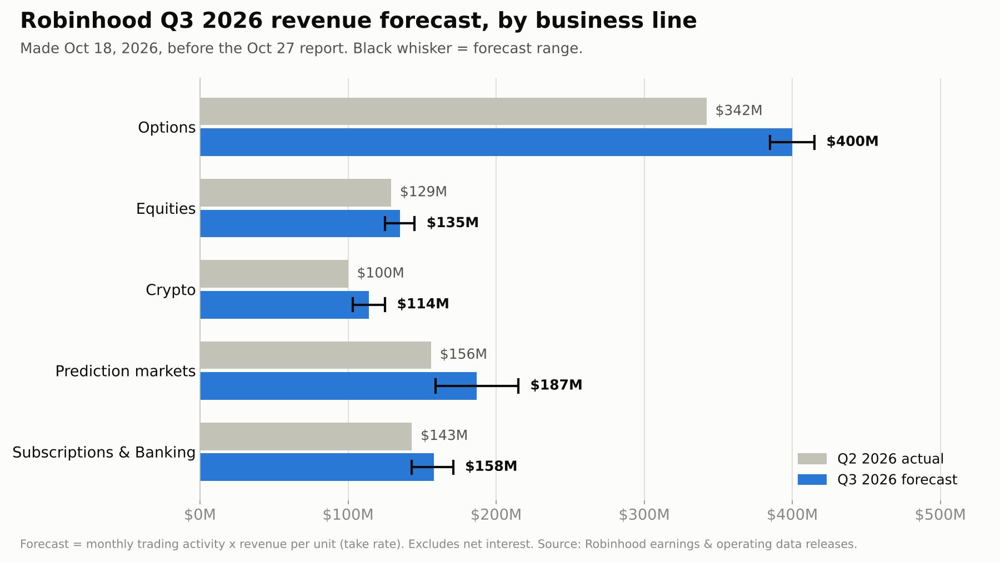

# Robinhood, Unbundled

**Five businesses, one stock: profitability, margins, competitiveness, growth and value by business line**

*Robinhood Markets, Inc. (NASDAQ: HOOD) · Data through Q2 2026 · Prices as of October 16, 2026 close ($98.87 per share, company valued at $88.9B) · Q3 2026 forecast made October 18, 2026*

Julie Loyez · [Interactive dashboard](https://public.tableau.com/app/profile/julie.loyez/viz/RobinhoodUnbundled/RobinhoodUnbundled) · [Code and data](https://github.com/julixlyz08/robinhood-unbundled)

---

## Summary

Robinhood tells investors how much revenue each of its products brings in, but only reports profit for the company as a whole. This note splits Robinhood into five businesses and asks the same questions of each: does it make money, how much does it earn per trade or customer, is it beating its competitors, is it growing, and what is it worth?

| Business line | Q2 2026 revenue | Growth vs a year earlier | Est. profit margin | Est. value |
|---|---|---|---|---|
| Options | $342M | +29% | ~45% | $19.0B |
| Equities (stocks) | $129M | +95% | ~45% | $6.4B |
| Crypto | $100M | −38% | ~45% | $3.4B |
| Prediction markets | $156M | more than 10× (per Robinhood) | ~45% | $10.4B |
| Subscriptions & Banking | $143M | +54% | 14% | $4.2B |

*Profit margin = share of revenue left after all costs. The four trading lines show the same ~45% because Robinhood doesn't disclose which costs belong to which product (see Section 7).*

**Six findings:**

1. **Trading revenue grows because people trade more, not because Robinhood charges more.** Robinhood earns about $0.44 per options contract, roughly the same as two years ago. Revenue rises because customers trade more, and more of that trading happens at Robinhood: among the brokers that publish comparable numbers, its share of options contracts rose from 50% to 54% in a year.
2. **Each extra trade is almost pure profit.** The costs that come with each trade (exchange and clearing fees) are only about 8% of trading revenue. Everything else, such as engineers, offices and marketing, costs the same whether customers trade a little or a lot.
3. **But growth is now turning into less profit than before.** From mid-2024 to Q3 2025, every extra $1 of revenue (compared with a year earlier) added 69–87¢ of operating profit. In the last three quarters it added only 29–55¢, because Robinhood's costs grew 33% in a year as it spent on new projects.
4. **Prediction markets already bring in more than crypto** ($156M vs $100M in Q2 2026), about a year after launch. Robinhood mostly resells contracts from exchanges like Kalshi, which keep most of the money; that's why it launched its own exchange, Rothera, in June.
5. **If customers trade less, profit falls twice as fast as revenue.** Since most costs don't shrink with trading, a 30% drop in trading would cut revenue by 18% but operating profit by 37%. Robinhood would still be profitable unless trading fell about 80%.
6. **The stock is priced well above what its businesses are worth at competitors' prices.** Valuing each of the five businesses like its closest listed competitor gives about $57B in total; the stock market values Robinhood at $89B. Investors are paying about $32B extra, betting that Robinhood keeps growing ~30% a year.

### Terms used in this note

- **Take rate:** what Robinhood earns per unit of customer activity: dollars per options contract, or cents per $100 of stock or crypto traded.
- **Basis point (bp):** one hundredth of one percent. Earning 1 bp on $10,000 of stock traded means earning $1.
- **Notional volume:** the dollar value of what customers trade. Buying $5,000 of Apple stock is $5,000 of notional volume.
- **Operating profit / profit margin:** revenue minus the costs of running the business (before interest and taxes). The margin is that profit as a share of revenue.
- **Market cap:** the share price times the number of shares, i.e. what the stock market says the whole company is worth.
- **Revenue multiple:** a company's value divided by its yearly revenue. A company worth $100B with $10B of revenue trades at "10× revenue". It's a quick way to compare how richly companies are valued.

---

## 1. Why split Robinhood into five businesses?

In mid-2021, crypto was over half of Robinhood's trading revenue, and the company was widely seen as a meme-stock and crypto app. By Q2 2026, crypto was 13% of trading revenue, and Robinhood says it has 13 product lines each bringing in over $100M a year. Revenue reached $1.31B in Q2 2026 (+32% from a year earlier), with net income of $573M.

Looking at Robinhood as one business hides that its products behave very differently: they earn different amounts per trade, face different competitors, and react differently when markets rise or fall. Robinhood reports revenue for each product but not the costs, so this note estimates the costs, with every assumption written down.

**What's covered.** Five business lines are analyzed. Two smaller pieces are left out of the detailed analysis but kept in the totals so everything adds up to the whole company: **net interest** (interest Robinhood earns on customers' cash and on loans to customers, 30% of revenue) and **other transaction revenue** (futures and other small products, 4%).

---

## 2. Options

**Profitability.** Options are Robinhood's largest business: $342M in Q2 2026, 26% of all revenue, and an estimated $154M of operating profit, the most of the five businesses.

**Earnings per trade.** Robinhood earns about **$0.44 per contract** traded, within a $0.44–0.52 range since 2024. It peaked at $0.51 in Q2 2025 and has drifted down since.

**Competitiveness.** Customers traded **50% more contracts** than a year earlier, against +17% at Interactive Brokers and +68% at Webull (which is much smaller). Of all the contracts traded across these three brokers, Robinhood's share rose from 50% to 54%.

**Growth.** Revenue grew 29% while the number of contracts traded grew 50%. The gap is the drop in earnings per contract ($0.51 → $0.44): Robinhood made a bit less on each contract but handled far more of them.

---

## 3. Equities (stocks)

**Profitability.** $129M in Q2 2026 and an estimated $58M of operating profit.

**Earnings per trade.** About **1.35 bps** of the dollar value traded, or $13.50 for every $100,000 of stock customers buy or sell. That's down from 1.7 bps in early 2024, and stable since mid-2024.

**Competitiveness.** The dollar value of stock traded on Robinhood grew **85%** in a year, more than at Webull (+73%). Schwab and Interactive Brokers only publish the number of trades, not their dollar value; their trade counts grew 57% and 36%. By either measure, Robinhood is growing fastest among the large brokers.

**Growth.** Revenue grew 95% while the dollar value traded grew 85%, so Robinhood also earned slightly more per dollar traded than a year earlier. This was the fastest-growing of the older trading lines.

---

## 4. Crypto

**Profitability.** $100M in Q2 2026 (−38% from a year earlier) and an estimated $45M of operating profit.

**Earnings per trade.** Looking at Robinhood's total crypto revenue divided by total crypto traded, it seems Robinhood now earns much less per trade: about 25 bps, down from 55 bps in mid-2025. That's misleading. In June 2025 Robinhood bought **Bitstamp**, a crypto exchange for professional investors that charges far lower fees. Separating the two: the **Robinhood app still earns about 55 bps**, while **Bitstamp earns about 0.5 bps**. The average fell because Bitstamp's volume was added in, not because Robinhood cut prices.

**Competitiveness.** Crypto traded on the Robinhood app fell 36% in a year, about the same as at Coinbase (−38%), so Robinhood held its ground in a weak crypto market. It does so as the cheap option: Coinbase earns about **175 bps** per dollar its retail customers trade, more than three times Robinhood's 55 bps. Bitstamp ($22B traded in the quarter) is still small next to Coinbase's professional business ($121B).

**Growth.** Negative, and driven by the crypto market: crypto traded −36%, revenue −38%. Of the five businesses, crypto revenue rises and falls the most with the market.

---

## 5. Prediction markets

**Profitability.** $156M in Q2 2026, up more than 10× from a year earlier according to Robinhood, and already more than crypto. Estimated operating profit is $70M, but this is the least certain number in the note, because Robinhood only started reporting this revenue separately last quarter.

**Earnings per trade.** About **1.1¢ per contract**, on 13.6 billion contracts traded in Q2: tiny bets, at enormous scale.

**Competitiveness.** At about $624M a year, Robinhood's prediction-market revenue is roughly **6× Coinbase's** ("$100M+"). But Robinhood has mostly been reselling contracts created on exchanges like Kalshi, and the exchanges keep most of the money: Kalshi reportedly brings in over $4B a year and Polymarket over $1B (press reports, not official filings). Kalshi was valued at $22B in its last funding round (and is reportedly in talks at $40B); Polymarket at $21B. In June 2026, Robinhood launched **Rothera**, its own regulated prediction-market exchange, run with the trading firm Susquehanna. Running the exchange itself is how Robinhood could keep more of each contract.

**Growth.** The fastest-growing line by far, and the hardest to forecast (Q3 forecast range: $159–215M).

**Regulation.** Some US states argue prediction markets are illegal gambling; New York sued Coinbase and Gemini over them in 2026.

---

## 6. Subscriptions & Banking

**Profitability.** $143M of revenue in Q2 2026 (+54%) from Robinhood Gold subscriptions, Trump Account services, the Robinhood Gold credit card and Robinhood Banking. It's the least profitable of the five: an estimated **14%** profit margin ($20M). The main cost is $56M set aside for credit card balances customers may not repay.

There's an accounting wrinkle that makes this business look worse than it is. The credit card's losses are counted in this business, but the interest customers pay on their card balances is counted elsewhere, under "net interest". Counting roughly $25M a quarter of that interest here would raise the margin to about 20%.

**Earnings per customer.** About **$119 of revenue per Gold subscriber per year**, compared with $67–106 during 2025. Fees from Trump Accounts helped in Q2 2026.

**Competitiveness.** Gold subscribers grew **37%** to 4.8M, and about 40% of new customers sign up for Gold. Revenue grew 54%, faster than SoFi's comparable business (+29%) and Coinbase's subscription business (−12%). Robinhood Banking holds over $3B of deposits from 240,000 customers, and the credit card business passed $100M of yearly revenue.

**Growth.** Steady: of the five businesses, this is the one that moves least with markets. Its value is also in what it does for the rest of Robinhood: it brings customers in and keeps their money on the platform, where they trade.

---

## 7. How much profit each business makes, and the company overall

**How profit is estimated.** Robinhood reports its costs for the company as a whole: exchange and clearing fees, technology, operations, marketing, and general and administrative costs. To estimate each business's profit, the costs are split with simple rules:

- **Exchange and clearing fees** go to the trading businesses, in proportion to their revenue.
- **Credit-card losses** go to Subscriptions & Banking.
- **Everything else** (engineers, offices, marketing, management) is shared by all businesses in proportion to their revenue.

Because the shared costs are split by revenue, the four trading businesses all come out at about the same margin (~45%). Robinhood doesn't publish anything that would separate them further, so the note doesn't pretend to. The useful comparison is between the trading businesses (~45%) and Subscriptions & Banking (14%). Alternative rules, such as giving crypto and prediction markets higher fees, or more marketing to Subscriptions & Banking, move the margins by only a few points.

**The company overall.** Robinhood kept 44% of its revenue as operating profit in Q2 2026, the same as a year earlier, even though revenue grew 32%. That's because costs grew just as fast (+33%). Looking at it another way: from mid-2024 to Q3 2025, each extra $1 of revenue compared with a year earlier added 69–87¢ of operating profit. In the last three quarters, it added only 29–55¢.

That's a choice rather than a problem: the extra spending pays for Rothera, Trump Accounts (over 7 million sign-ups and nearly $1.5B deposited since launching on July 4, 2026), international expansion (a Singapore license in July 2026, the WonderFi acquisition in Canada) and earlier acquisitions (Bitstamp, TradePMR). Whether that spending pays off is the central question for the stock.

---

## 8. What if customers trade less?

Trading revenue is simply activity × earnings per trade, so the most direct risk for Robinhood is customers trading less, as happened in 2022. This section estimates what that would do to revenue and profit.

**How the test works.** Start from Q2 2026 and lower trading activity in all trading businesses by the same percentage. Robinhood keeps earning the same amount per trade. On the cost side, only exchange and clearing fees (about 8% of trading revenue) shrink with trading; salaries, technology, marketing and offices ($672M a quarter) stay the same, as they would in the short run. Subscriptions & Banking and net interest are kept unchanged.

| Scenario | Total revenue | Change | Operating profit | Change | Profit margin |
|---|---|---|---|---|---|
| Q2 2026 actual | $1,308M | | $574M | | 44% |
| Trading −10% | $1,230M | −6% | $503M | −12% | 41% |
| Trading −20% | $1,153M | −12% | $431M | −25% | 37% |
| Trading −30% | $1,075M | −18% | $360M | −37% | 33% |
| Trading −50% | $920M | −30% | $217M | −62% | 24% |
| Repeat of 2022* | $1,011M | −23% | $301M | −48% | 30% |

*Each business falls by as much as its revenue fell from late 2021 to its 2022–2023 low: options −31%, stocks −60%, crypto −52%. Prediction markets and other transaction revenue didn't exist then; they're assumed to fall like options.

**What it means.**

- **Profit falls about twice as fast as revenue.** The fixed costs that made the last two years so profitable work in reverse when trading slows.
- **For each trading business, a 30% drop in trading cuts profit by about 60%.** Options' profit would fall from $154M to $59M a quarter, and its margin from about 45% to about 25%. Subscriptions & Banking is the only business unaffected.
- **Robinhood is still far from losing money.** Operating profit only reaches zero if trading falls by about 80% with no cost cuts. In the 2022 downturn, trading revenue fell about 30% from its late-2021 level.
- **What would soften the blow:** management could cut marketing or slow hiring, which this short-run test doesn't assume. Robinhood also tends to earn slightly more per dollar of stock traded when activity is low, but the effect is small (about 1 percentage point of profit).
- **What would make it worse:** in 2022, subscription revenue also fell, and customers borrow less from Robinhood when they trade less, which would reduce net interest. Both are kept unchanged here.

**Which businesses follow the market most?** A statistical comparison of each business's quarterly revenue since 2021 with two market indicators, the Bitcoin price and the **VIX** (an index of how nervous stock investors are; it rises when markets fall sharply), shows how much each business rises and falls with markets rather than growing steadily. Crypto follows the market most, then stocks, then options; Subscriptions & Banking follows it least. The Bitcoin price lines up with every trading business, including options and stocks, while the VIX doesn't. That suggests trading on Robinhood rises and falls with how much risk its customers are willing to take.

---

## 9. What is Robinhood worth?

**The approach.** A common way to value a company made of several businesses is to value each business separately, as if it were its own company, and add them up (a "sum-of-the-parts" valuation). Each business here is valued like its closest listed competitor: if investors value Schwab and Interactive Brokers at 4–16 times their yearly revenue, Robinhood's options and stock businesses get a similar multiple. The revenue used is the analysts' average forecast for 2027 ($6.85B in total), split between the businesses using this note's forecast.

| Business | 2027 revenue | Value ÷ revenue (low – middle – high) | Compared with | Value, middle case |
|---|---|---|---|---|
| Options | $1.9B | 4.1× – 9.9× – 15.8× | Schwab – Interactive Brokers | $19.0B |
| Equities | $0.6B | 4.1× – 9.9× – 15.8× | Schwab – Interactive Brokers | $6.4B |
| Crypto | $0.5B | 5.0× – 6.2× – 7.5× | Coinbase | $3.4B |
| Prediction markets | $0.9B | 5.5× – 11.6× – 14.6× | Kalshi – stock exchanges – CME | $10.4B |
| Subscriptions & Banking | $0.8B | 3.1× – 5.5× – 8.0× | SoFi (upper end is a judgment call) | $4.2B |
| Other transaction (not analyzed) | $0.2B | 4.1× – 9.9× – 15.8× | Schwab – Interactive Brokers | $2.3B |
| Net interest (not analyzed) | $1.9B | 3.1× – 4.1× – 6.0× | SoFi – Schwab | $7.6B |
| Cash minus debt | | | | $3.2B |
| **Total** | | | | **$57B (range $30–82B)** |
| **What the stock market values Robinhood at (Oct 16, 2026)** | | | | **$88.9B** |

**What it means.**

- **Investors value Robinhood at more than its businesses are worth at competitors' prices**: $89B, against $57B in the middle case, and even more than the $82B high case. In other words, the stock is expensive compared with what Robinhood's businesses earn today. Investors are paying the extra ~$32B because they expect Robinhood to keep growing much faster than its competitors, and because new projects (Rothera, international expansion, Trump Accounts) could become large businesses. That is neither good nor bad by itself: it is a bet. If growth continues, today's price can be justified; if growth slows to a normal broker's pace, the ~$57B is a more realistic anchor.
- **One way to see the size of that bet:** if all of the extra $32B were attributed to prediction markets, investors would be valuing that one business at about $43B, or **48 times its yearly revenue**, while comparable exchanges are valued at roughly 6–15 times revenue. $43B is about twice Kalshi's last valuation, for a business that has mostly resold Kalshi's contracts.
- **Adjusted for growth, the price looks more reasonable.** Robinhood is valued at 12.5 times the revenue analysts expect next year, and that revenue is expected to grow about 39%. Per point of expected growth, that's cheaper than Interactive Brokers or Coinbase, though more expensive than Schwab or SoFi.

---

## 10. Q3 2026 revenue forecast (made before the October 27 report)

**How it works.** Robinhood publishes how much its customers traded each month. For each business, the forecast multiplies the activity in July, August and September by what Robinhood earned per trade last quarter. For September, only the first 24 days had been published, so the full month was estimated from them. To check the method, it was tested on the past nine quarters: on average it was off by 3.8% for options and 7.5% for stocks. Those past errors set the low and high ends of each range.

| Business | Q2 2026 actual | Q3 2026 forecast | Range |
|---|---|---|---|
| Options | $342M | $400M | $385–415M |
| Equities | $129M | $135M | $125–145M |
| Crypto | $100M | $114M | $103–125M |
| Prediction markets | $156M | $187M | $159–215M |
| Subscriptions & Banking | $143M | $158M | $143–171M |
| Other transaction + net interest (kept near Q2, ±5%) | $438M | $438M | $417–459M |
| **Total revenue** | **$1,308M** | **$1,432M** | **$1,332–1,530M** |

*Comparison with reported results: to be added after October 27, 2026.*

---

## 11. Personal thesis

*To be written.*

---

## 12. Limits of this analysis

- **Profit by business is an estimate.** Robinhood doesn't report costs by product, so the split relies on stated rules (Section 7).
- **Short history.** Robinhood only started publishing trading volumes in 2024 and prediction-market revenue in Q2 2026.
- **The trading-drop test is short-run.** It assumes Robinhood keeps its earnings per trade and doesn't cut costs, and it keeps Gold revenue and net interest unchanged. The 2022 repeat uses revenue declines because trading volumes weren't published then.
- **Subscriptions & Banking looks worse than it is**, because part of its income is counted under net interest.
- **Valuations change daily.** The comparison uses prices from October 16, 2026; the Subscriptions & Banking multiple and Kalshi's revenue are the least certain inputs.
- **Regulation.** Prediction markets and crypto both face open legal questions in the US.

---

## Methodology

- **Data.** 21 quarters (Q2 2021–Q2 2026) from Robinhood's earnings releases (SEC 8-K Exhibit 99.1 and investors.robinhood.com), each reconciled to reported totals; Robinhood's monthly operating data for April–September 2026; competitors' earnings releases and filings; VIX and Bitcoin prices from Yahoo Finance; share prices and analyst forecasts as of the October 16, 2026 close.
- **Earnings per trade (take rates).** Revenue divided by activity for each business. The Robinhood app's and Bitstamp's crypto rates are solved from Q1 and Q2 2026 together.
- **Profit by business.** Exchange and clearing fees are split between trading businesses by revenue (alternative: double weight on crypto and prediction markets); credit losses go to Subscriptions & Banking; all other costs are split by revenue (alternative: 1.5× marketing weight on Subscriptions & Banking). Another alternative moves $25M a quarter of card interest from net interest to Subscriptions & Banking. The pieces always add up to Robinhood's reported operating profit.
- **Trading-drop test.** Q2 2026 base; trading revenue falls with activity at constant earnings per trade; exchange and clearing fees fall with trading revenue; all other costs, Subscriptions & Banking and net interest are held constant.
- **Market sensitivity.** Regressions (in logs) of quarterly revenue on a time trend, the quarterly average VIX and the average Bitcoin price, 2021–2026.
- **Valuation.** Enterprise value divided by 2027 consensus revenue for listed competitors; 2027 revenue split by the forecast mix; net cash of $3.16B (cash minus the convertible notes due 2029).

All code, data and assumptions: [github.com/julixlyz08/robinhood-unbundled](https://github.com/julixlyz08/robinhood-unbundled).

*This note is an independent analytical project, not investment advice.*
